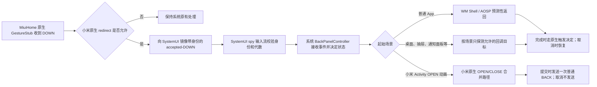

# 功能实现与代码地图

本文按用户可见行为说明当前代码的入口、协作关系、配置项和已知边界。代码是最终事实；若本文与源码不一致，应以源码和 `AGENTS.md` 为准，并同步修正文档。

## 项目边界

- 模块：基于 libxposed API 102 的 LSPosed 模块。
- 静态作用域：`com.android.systemui`、`com.miui.home`、`system`，见 `app/src/main/resources/META-INF/xposed/scope.list`。
- 手势输入与动画主干以 SystemUI / WM Shell 为中心；MiuiHome 只保留原生触摸所有权、启动器状态镜像和小米桌面返回动画协作。
- 不把用户选择的目标 App 加进 LSPosed 作用域。预测性返回选择通过 API 102 RemotePreferences 写入，并仅由已有 `system` 作用域读取。
- 不为融合设备中心另装桌面拦截器。之前尝试修复桌面里的融合设备页面时识别不稳定，已按性能要求移除额外逻辑；该页面在桌面上仍是已知未解决项。

## 一次边缘返回的主流程

### 1. 手势路由、返回进度与动画打断

**主要代码**

- `app/src/main/java/dev/codex/miuibackgesturehook/hooks/miuihome/MiuiHomeHookRuntime.java`
- `app/src/main/java/dev/codex/miuibackgesturehook/hooks/systemui/SystemUiInputRuntime.java`
- `app/src/main/java/dev/codex/miuibackgesturehook/hooks/systemui/SystemUiHookRuntime.java`
- `app/src/main/java/dev/codex/miuibackgesturehook/hooks/core/HookRuntimeCore.java`
- `app/src/main/java/dev/codex/miuibackgesturehook/hooks/hotreload/HotReloadHookRuntime.java`

MiuiHome 原生 `GestureStubView` 继续持有物理边缘触摸区域和 DOWN 的 redirect 判定。SystemUI 的模块输入通道是 spy；只有收到同一个 MotionEvent 身份、显示器、边缘和当前仲裁代数的 accepted-DOWN 后，才可接管并 pilfer。SystemUI 原生 `BackPanelController` 仍是指示球状态、阈值、释放提交/取消及默认震动的唯一所有者。

普通应用沿 AOSP Shell 的预测性返回流程运行。当前 Activity 的小米原生 OPEN 进入动画如果仍可逆，则保留小米 OPEN/CLOSE 合并机制；手势提交时只发送一次普通 BACK，让小米的原生动画接收旧式打断信号；取消时不发送 BACK。没有有效 Shell 目标的桌面探测保持未接管，不合成事件。桌面空闲页和桌面文件夹保留 MiuiHome 自己的输入路线，避免吞掉桌面滑动和文件夹关闭。

桌面最近任务、应用抽屉、编辑状态、通知栏/控制中心覆盖桌面等情况，依各自镜像状态决定是否探测 Shell，并且只接受预期的回调类型。状态广播显式发送到对端，并校验包名与 UID 归属。

手指越过 `8dp` 向外阈值后才接管普通 App 流；垂直先动不终止流，后续水平运动仍可通过小米的方向意图门限。Shell 读取和提交在 Shell executor 上完成；SystemUI 输入 Looper 不直接查看 Shell 私有 transition/animator 容器。

小米 Activity 进入动画与跨 Activity AOSP 返回是两套拥有者不同的流程。不要把小米 OPEN 的 legacy BACK 信号误当作普通 AOSP 退出，也不要为了二次手势直接清除前一段 Shell 动画。

### 2. 桌面窗口与小窗识别

**代码**：`MiuiHomeHookRuntime.java`、`SystemUiHookRuntime.java`。

桌面全屏 App 刚缩成小窗时，MiuiHome 的 `getNormalSmallWindows()` 暂时也可能包含紧凑态窗口。当前镜像逻辑进一步检查 `windowState == 0`、`isNormalFreeForm`、非贴边 pin、非隐藏/退出状态及稳定放大比例；状态不完整时按桌面普通输入处理。放大前台小窗允许返回；缩小态和贴边隐藏态仍按原逻辑屏蔽。当前没有焦点轮询或焦点判定，以免把焦点切换竞态和额外查询带进热路径。

这是最近收紧的判定，需在目标设备按“全屏 App → 桌面小窗 → 放大/缩小/贴边”分别复测；MiuiHome 版本的字段与比例语义可能变化。

### 3. AOSP 预测性返回兼容名单

**代码**：

- `activity/PredictiveBackAppListActivity.kt`
- `activity/PredictiveBackSettingsActivity.kt`
- `hooks/systemserver/SystemServerHookRuntime.java`
- `PredictiveBackPreferences.java`

应用列表支持显式启用预测性返回、按包名添加未列出的应用，并可显示没有桌面启动图标的包。配置通过 API 102 RemotePreferences 保存；只有目标应用新建 Activity 时，`system_server` 才对当前 launch `ActivityInfo` 的 opt-in 标记做调整，不修改共享的 `ApplicationInfo`。修改后应完整重启目标 App。

预测性返回 opt-in 会让应用把系统 BACK 交给平台预测性回调。使用单 Activity 自建导航、WebView、Compose Navigation 或自定义路由的 App 可能跳过自己的页面栈直接返回桌面；名单默认应保持空，逐个测试。

### 4. AOSP 返回背景与桌面壁纸

**代码**：`SystemUiHookRuntime.java`、`SystemUiInputRuntime.java`、`PredictiveBackPreferences.java`、`activity/PredictiveBackSettingsActivity.kt`。

AOSP 预测性返回颜色层有三种配置：系统默认填充、纯黑、桌面壁纸。壁纸模式读取系统壁纸快照并按 wallpaper ID 缓存，在动画颜色层之下建立 Surface；可选模糊由合成器的 blur layer 提供。动画结束、取消或替换时释放对应 Surface。跨 Activity 的下层真实 App / 桌面表面仍由 Shell 控制，因此壁纸层应处于它们之后；不能把下层 Activity 隐藏掉来伪造“两个 Activity 后面的背景”。

该设置当前作用于 AOSP `CrossActivityBackAnimation` 的共享颜色层。源码中的 HyperOS slide 路径明确保留其原有黑色填充；因此“壁纸/自定义填充同样用于 HyperOS 原生侧滑动画”仍未实现，不能在 UI 或 PR 说明中宣称已完成。AOSP 壁纸模糊稳定后已不再标为实验性。

MiuiHome 的 Back-to-home 预览则通过小米原生 `WindowElement`、壁纸参数和原生 spring 协作；预览取消时恢复模块拥有且仍未被小米替换的状态，提交时把状态交给小米原生收尾。它与 AOSP 跨 Activity 颜色填充是相关但不同的状态机。

### 5. AOSP 返回小球实时高斯模糊

**代码**：

- `hooks/systemui/BackPanelMaterialController.java`
- `hooks/systemui/SystemUiHookRuntime.java`
- `hooks/systemui/SystemUiInputRuntime.java`
- `activity/PredictiveBackSettingsActivity.kt`

模糊由 Android `ViewRootImpl.createBackgroundBlurDrawable()` 创建，并在原生 `BackPanel.onDraw(Canvas)` 中、原生箭头绘制前绘制。原生小球承载 Paint 只去掉填色，箭头和系统面板动画继续由原生 View 绘制。没有另外创建触摸窗口或慢消失遮罩层。

配置项在一次手势开始时读取并传入面板状态；绘制帧不读取偏好、不反射查询新方法、不临时分配 Path/Paint/Rect。模糊强度、材质透明度为滑块，长按标题恢复默认；轮廓高光是默认关闭的实验开关，复用缓存 Path 跟随变形边缘。

### 6. 触感反馈

**代码**：`MiuiHapticFeedbackHelper.java`、`SystemUiInputRuntime.java`、`PredictiveBackSettingsActivity.kt`、`PredictiveBackPreferences.java`。

- 默认使用 AOSP 原生 BackPanel 的阈值触感。
- 可选 HyperOS 指示器时，可选择 Xiaomi 的 ready-back / hand-up 原生效果。
- 自定义触感通过 Android vibrator composition 提供清脆、柔和、沉闷、双段四种预设；可调强度，并在设置滑动时预览。
- HyperOS 反馈与自定义反馈互斥；UI 会要求只开一个。强度只作用于当前选择的反馈实现。

设备振子可能不支持某些 primitive 或强度缩放；此时应降级而不是在手势 MOVE 阶段反复创建震动对象。

### 7. Back-to-home 与状态栏/屏幕表面

**代码**：

- `hooks/miuihome/MiuiHomeReturnHomeRuntime.java`
- `MiuiHomeReturnHomeLifecycleRuntime.java`
- `MiuiHomeReturnHomePreviewRuntime.java`
- `MiuiHomeReturnHomeStateRuntime.java`
- `MiuiHomeReturnHomeUnifiedRuntime.java`
- `MiuiHomeReturnHomeUnifiedCommitRuntime.java`
- `hooks/systemserver/SystemServerHookRuntime.java`

返回桌面动画使用 Shell 提供给 Launcher 的标准 `IBackAnimation` Binder callback/runner 和小米自己的 `WindowElement` / `RectFSpringAnim`。预测性预览与提交后的 CLOSE 绑定到同一小米动画对象；真实 App Surface 保持为画面内容，不使用截图替身。桌面壁纸、快捷图层和预览状态按 session 所有权在取消恢复、提交移交。

旧版桌面兼容重点是标准 Shell 入口和 Launcher callback/runner 注册；项目实测记录包含 Redmi K90 Pro Max / HyperOS 3.0.23，以及 System Launcher `RELEASE-7.00.00.2300-06091632`。其他版本的私有字段仍需按设备检查。

SystemServer 的返回桌面触摸模式只在确认属于已提交 `TYPE_RETURN_TO_HOME` 且 Activity 已不可见、不可接触等边界后调整。Back-to-home 动画状态栏区域要保留系统请求的外观与沉浸行为，不能让动画窗口盖住状态栏；相关条件在 SystemServer path 中，不要用扩大 Launcher overlay 覆盖范围来补偿。

重复触发返回时，SystemUI 会捕获精确的跨 Activity post-commit ValueAnimator，并仅缩短该动画尾段；普通 animator 不受影响。该路径依赖动画身份与代数，不能改为全局加速或定时器。

### 8. 设置页面与手势触发区域

**代码**：`activity/PredictiveBackSettingsActivity.kt`、`activity/GestureTriggerSettingsActivity.kt`、`util/MiuixBlurEffect.kt`。

设置页使用 Miuix Compose 组件，统一展示 AOSP / HyperOS 指示器、背景、触感、日志、应用范围和手势区域。手势区域页调整两侧区域高度与垂直位置。长按强度/数值标题恢复默认；修改通过 remote preference 写入，并在写入失败时回到最后确认值。

### 9. 配置键速查

实际 key、默认值和范围集中在 `PredictiveBackPreferences.java`。常用项如下：

| 行为 | Preference | 默认/范围 |
| --- | --- | --- |
| AOSP 返回小球模糊 | `aosp_back_panel_hyper_material` | 关闭 |
| 小球模糊半径 | `aosp_back_panel_blur_radius` | 96 px，24–200 |
| 小球颜色覆盖透明度 | `aosp_back_panel_transparency_percent` | 86%，50–100；越高颜色覆盖越淡 |
| 小球边缘高光 | `aosp_back_panel_highlight` | 关闭，实验性 |
| AOSP 返回背景 | `aosp_background_mode` | 系统；可选黑色/壁纸 |
| 壁纸背景模糊 | `aosp_wallpaper_blur` | 关闭 |
| HyperOS 指示箭头 | `hyperos_indicator_style` | 关闭 |
| HyperOS 手势震动 | `hyperos_indicator_haptics` | 关闭 |
| 自定义触感与预设 | `custom_gesture_haptics`, `custom_gesture_haptics_preset` | 关闭/清脆 |
| 触发区域高度、位置 | `gesture_trigger_height_percent`, `gesture_trigger_position_percent` | 100% / 0% |

## 目前已知边界

1. 融合设备中心从桌面打开的设备页仍无法稳定触发模块返回；为降低性能成本，专用 hook 已撤掉。
2. AOSP 壁纸/纯黑填充与背景模糊不覆盖 HyperOS 原生侧滑动画；HyperOS 原生动画仍有自己的背景填充。
3. 放大小窗/缩小小窗判定最近加了状态和缩放门限，但需要在目标 ROM 做冷热启动、缩放、贴边和多窗口切换复测。
4. 天气桌面卡片在上一段返回桌面动画未结束时立即重开 App 的进入动画闪现，需要独立的设备日志复测；不要因为这份说明把它算成已确认修复。
5. 高光属于实验性绘制；不同 DPI、颜色主题和 BackPanel 尺寸下仍需实机观感确认。

